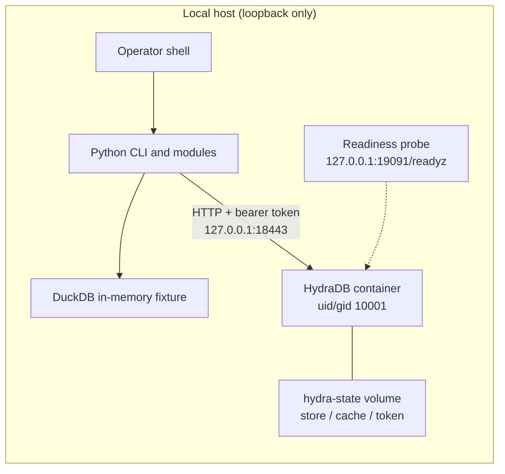
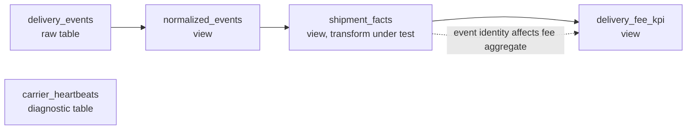
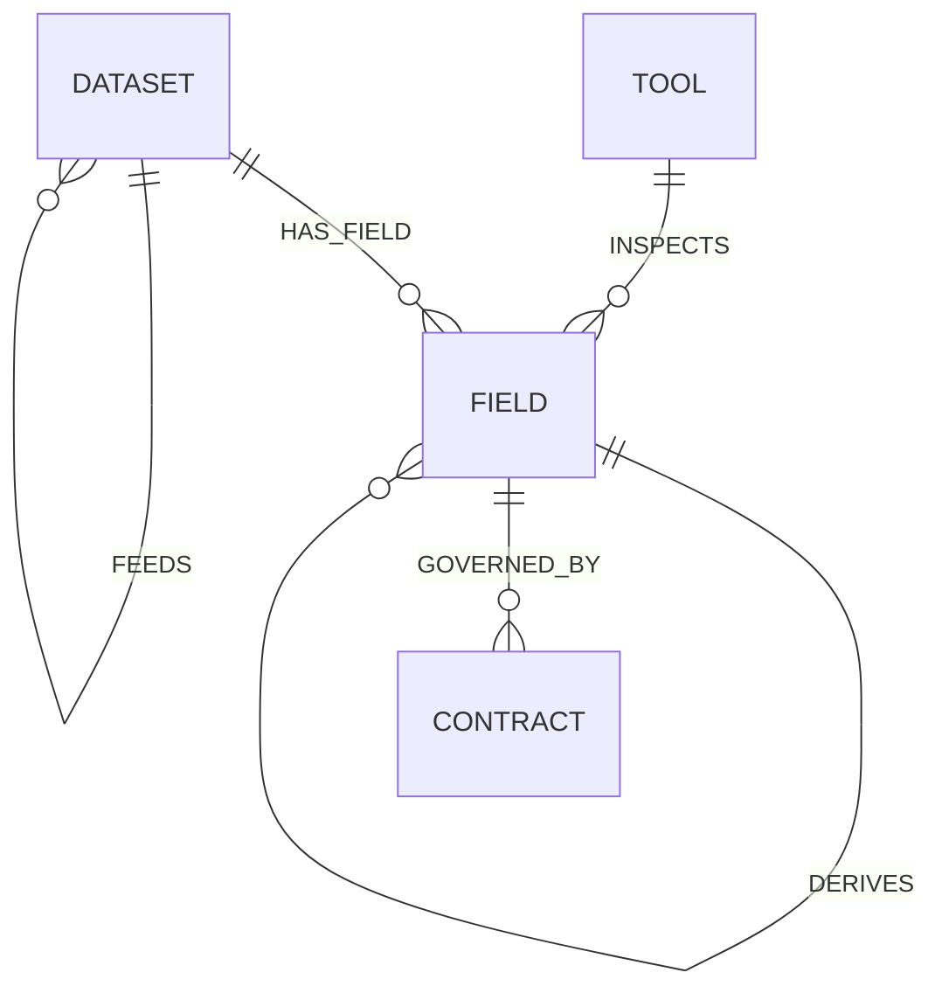
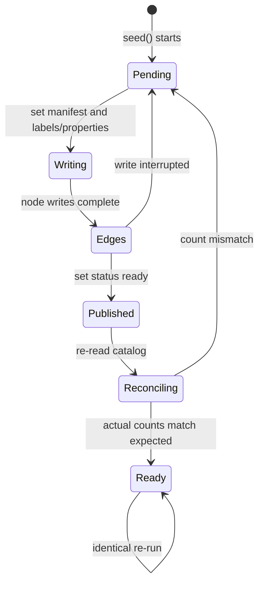
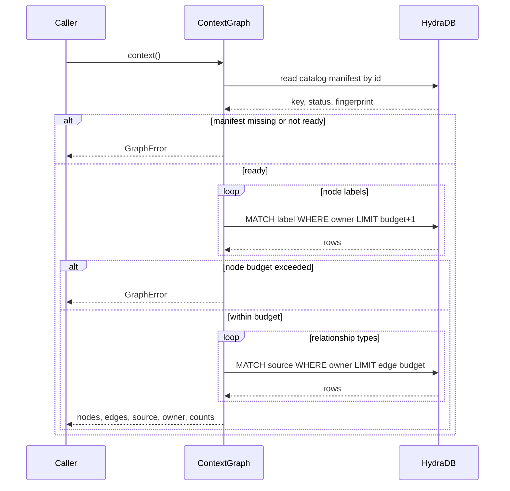
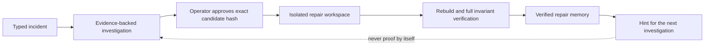

# Architecture

Aftertrace is an evidence-backed context workbench for data incidents. This document describes what is implemented in phases 1–3: a local HydraDB runtime and transport, a deterministic synthetic warehouse, and a bounded context catalog. Investigation, approval, isolated repair, verification orchestration, verified-repair memory, API/UI, and evaluation are planned but not part of the documented shipped surface.

## 1. System boundaries



The repository contains no web server, HTTP API, UI, or public SQL surface. The operator runs CLI scripts and Python modules. HydraDB exposes its own authenticated query API on loopback. The fixture is created inside the Python process and is discarded when the process exits.

| Component | File | Responsibility |
| --- | --- | --- |
| Transport | `hydra.py` | Validate endpoints, send bearer-authenticated Cypher, decode typed cells, paginate, sanitize failures. |
| Configuration | `app/config.py` | Load local `.env` defaults, connect to HydraDB with explicit graph/cell/namespace. |
| Fixture | `app/fixture.py` | Generate the synthetic warehouse, apply a candidate transform, measure, and verify invariants. |
| Context catalog | `app/graph.py` | Introspect fixture schemas, build declared lineage, ingest, and perform bounded reads. |
| Runtime setup | `scripts/setup_runtime.py` | Create a private `.env` token without displaying or overwriting it. |
| Runtime smoke | `scripts/runtime_smoke.py` | Exercise authenticated write/read/delete and restart-persistence scratch markers. |
| Fixture CLI | `scripts/check_fixture.py` | Emit JSON measurements and invariant results for a scenario/seed/candidate. |
| Catalog CLI | `scripts/ingest_context.py` | Seed a scope and print catalog counts plus a field neighborhood. |
| Runtime | `compose.yaml` | Pin the engine image, initialize the volume, and publish query/admin ports on loopback. |
| Tests | `tests/` | Unit tests plus opt-in live HydraDB tests in scratch scopes/IDs. |

## 2. Fixture and warehouse

`app/fixture.py` builds a DuckDB database in memory. It has no external inputs, no network calls, and no persistent warehouse. The default transform is deliberately broken; candidate transforms are supplied by local code or tests.



| Relation | Kind | Purpose |
| --- | --- | --- |
| `delivery_events` | table | Raw accepted and replayed delivery events. Columns: `event_id`, `shipment_id`, `source`, `status`, `fee_cents`, `event_day`. |
| `normalized_events` | view | Type casts and lowercase normalization; keeps duplicate rows. |
| `shipment_facts` | view | Built with the transform under test, including `BROKEN` and `FIXED`. |
| `delivery_fee_kpi` | view | Daily fee aggregate: `event_day`, summed `fee_cents`, `shipments`, distinct `events`. |
| `carrier_heartbeats` | table | Non-critical freshness metadata; disconnected from fee lineage. |

### Deterministic generation and scenarios

For seed `s`, shipments are `1..100`, one canonical `delivered` event per shipment. `event_day = 1 + shipment_id // 10`; `fee_cents = 400 + ((shipment_id * 17 + s) % 300)`; sources alternate by shipment parity. Seed validation is `1..10000`.

| Scenario | Shape | Intended result |
| --- | --- | --- |
| `healthy` | No replays, fresh heartbeats | Control; all 11 invariants pass. |
| `duplicate` | Byte-identical replays from one source partition | Default transform fails uniqueness, fees, accounting, and partition conservation. |
| `duplicate_heldout` | Replays a different partition with different event IDs | Tests repairs that are not tied to training identifiers. |
| `stale` | Late deliveries missing | Completeness fails even after deduplication. |

`duplicate`/`duplicate_heldout` also stop refreshing the non-duplicated partition's heartbeat feed from day 5. That feed is non-critical and its partition has no duplicate events, so it cannot explain fee inflation.

### Verification boundary

`verify(db, seed)` returns 11 `{name, passed}` checks:

1. event uniqueness
2. shipment completeness
3. fee reconciliation
4. source coverage
5. non-null event identity
6. one delivery per shipment
7. positive fees
8. accepted event accounting
9. carrier partition conservation
10. non-null required values
11. accepted event content conservation

Expected canonical counts and fees are recomputed from the public seed. Scenario names, causes, and answers are not stored in warehouse tables. `measure(db)` exposes actual counts, rates, per-source accounting, daily history, reconciliation, and heartbeat freshness. `FIXED` keeps one canonical row per `event_id`; filters that drop a partition or relabel events fail the broader checks even if totals look plausible.

The candidate transform is a trusted internal argument, not a sandboxed public API. See [Security](SECURITY.md).

## 3. Context graph model

HydraDB stores an application-owned property graph. It has no server-enforced schema; labels, properties, and relationship types are conventions enforced by `app/graph.py`.



| Node label | Key properties | Source |
| --- | --- | --- |
| `Dataset` | `id`, `key`, `owner`, `name`, `layer`, `detail` | Relation names from the fixture; layer is `raw`, `model`, or `metric`. |
| `Field` | `id`, `key`, `owner`, `name`, `layer`, `detail` | `DESCRIBE` against the fixture; `detail` holds JSON type/nullability. |
| `Contract` | `id`, `key`, `owner`, `name`, `layer`, `detail` | Declared meaning/version for `event_id`, `shipment_id`, and `fee_cents` where present. |
| `Tool` | `id`, `key`, `owner`, `name`, `layer`, `detail` | Read-only diagnostic capability metadata; `detail` holds operation/input/version JSON. |
| `Catalog` | `id`, `key`, `status`, `fingerprint` | One manifest node per scope/version, outside the counted catalog. |

Edges carry endpoint IDs only. There are no edge properties.

| Relationship | Direction | Meaning |
| --- | --- | --- |
| `HAS_FIELD` | `Dataset -> Field` | The field belongs to the dataset. |
| `FEEDS` | `Dataset -> Dataset` | One pipeline relation supplies the next. |
| `DERIVES` | `Field -> Field` | A downstream field depends on an upstream field. |
| `GOVERNED_BY` | `Field -> Contract` | The field's declared semantics and version. |
| `INSPECTS` | `Tool -> Field` | The diagnostic tool can inspect that field. |

### Declared lineage and cardinality

Dataset lineage is declared for the owned SQL pipeline: `delivery_events -> normalized_events -> shipment_facts -> delivery_fee_kpi`. Matching-name field edges are added between each consecutive pair of those relations. `carrier_heartbeats` is intentionally disconnected; no upstream lineage is invented for it.

`delivery_fee_kpi.fee_cents` is a sum, and `delivery_fee_kpi.shipments`/`events` count rows and distinct event identities. Aggregate fee correctness therefore depends on canonical event identity as well as fee values. The graph records this explicitly as `shipment_facts.event_id -[:DERIVES]-> delivery_fee_kpi.fee_cents`, even though the field names differ.

For the actual `fulfillment-v2` healthy fixture:

| Item | Count |
| --- | ---: |
| Datasets | 5 |
| Fields | 27 |
| Contracts | 10 |
| Tools | 4 |
| **Catalog nodes** | **46** |
| `HAS_FIELD` | 27 |
| `FEEDS` | 3 |
| `DERIVES` | 15 |
| `GOVERNED_BY` | 10 |
| `INSPECTS` | 8 |
| **Edges** | **63** |

These counts change if the schema or declared lineage changes.

## 4. Ingestion lifecycle, scope, and identity



`ContextGraph.seed()` performs these steps:

1. Build or accept a DuckDB fixture and introspect each owned relation with `DESCRIBE`.
2. Build catalog nodes/edges and reject a catalog larger than the node budget before any write.
3. Compute a SHA-256 fingerprint over the deterministic node list and sorted edge list.
4. Compare an existing manifest. A different key or fingerprint fails rather than overwriting another catalog.
5. Derive IDs, reject in-memory duplicates, then check each existing ID's key before writing.
6. Upsert the manifest as `pending`, then labels/properties grouped by node type.
7. Write edges by relationship type using the tested `UNWIND ... CREATE` shape, then set the manifest to `ready`.
8. Re-read the catalog and compare actual node/edge counts. A mismatch returns the manifest to `pending` and raises.

An interrupted edge write leaves the manifest `pending`; reads refuse to use it. Re-running the same input resumes and then reconciles. Identical re-ingestion returns the same catalog and counts. This is a single-operator publication guard, not a transaction or distributed lock; concurrent writers are out of scope. The implementation sets `ready` before re-reading for reconciliation, so concurrent readers could observe the catalog before final count checks. A count mismatch resets it to `pending`.

### Identity and collisions

```text
owner     = scope + ":" + fixture VERSION
node key  = owner + ":" + kind + ":" + name
node id   = 10^12 + int(sha256(node key) hex[:13], 16)
```

IDs are deterministic positive integers, not Python's process-randomized `hash()`. The manifest uses its own `owner + ":catalog"` key. Scope is validated to 1–80 characters. Every catalog node stores its full key and owner; reads filter by owner. Different scopes or fixture versions produce different IDs.

Before writing, the code checks for duplicate IDs in the batch and for an existing database ID whose key differs. A collision fails without overwriting metadata. Edges are written from ID pairs derived from the same catalog, and reads validate that every edge target is in the retrieved node set.

A schema, contract, or lineage change under the same scope and fixture version is rejected by the manifest fingerprint. Changing `VERSION` (or the scope) creates a new owner and fresh IDs; it does **not** delete older catalog nodes. That cleanup is a separate deliberate operation.

## 5. Read flow and budgets



| Operation | Behavior |
| --- | --- |
| `context()` | Requires a ready manifest. Loads each label within the node budget, then each relationship type whose source is owned, and rejects edges outside the retrieved node set or above the edge budget. |
| `search(text, limit)` | Loads context, then case-insensitive substring matches owned `Dataset` names client-side. Not a full-text engine. |
| `upstream(field, max_hops, limit)` | Finds the owned field, queries exact `DERIVES` depths 1..`max_hops`, keeps the shortest observed depth, excludes the starting field from cycles, and fails if a budget is exceeded. |
| `field_context(field, max_hops)` | Returns the target, its upstream fields, their contracts, and tools whose owner matches and that inspect any of those fields. Includes retrieval counts. |

| Setting | Default | Allowed / note |
| --- | ---: | --- |
| HTTP timeout | 15 s | Must be positive |
| HTTP page size | 256 rows | Fixed in the client |
| HTTP page budget | 1000 pages | Exceeded pages raise |
| Context scope | `aftertrace` | 1–80 characters |
| Context node budget | 128 | 1–256 |
| Context edge budget | `8 * node budget` per relationship type | Derived; includes a `+1` over-limit probe |
| Upstream hops | 3 | 1–4 |
| Upstream field budget | 32 | 1–64 |
| Search result limit | 10 | 1–32 |
| Fixture seed | 1 | 1–10000 |

These values are code defaults, not environment configuration. Context and traversal overflow raise instead of silently truncating evidence. Search intentionally returns at most its requested number of matching datasets; invalid hop/search bounds raise `ValueError`.

## 6. Transport semantics

`hydra.py` is a standard-library client for HydraDB's HTTP query endpoint.

| Concern | Implemented behavior |
| --- | --- |
| Endpoint | HTTP(S) only; hostname required; embedded credentials, query, and fragment rejected. |
| Remote plaintext | Rejected unless the host is `localhost`, `127.0.0.1`, or `::1`. |
| Authentication | Bearer token, graph, cell, and namespace are required; CRLF injection in token/namespace is rejected. |
| Request | `POST /v1/graphs/{graph}/query` with `Authorization` and `X-Graph-Namespace`; graph name is URL-encoded. |
| Parameters | Values travel in the parameters map; app query text and identifiers are built from constants. |
| Redirects | Disabled, so a bearer token is never forwarded to another endpoint. |
| Pagination | Sends `cursor` and the server `query_id`; holds column names stable; rejects width changes and missing paginated IDs. |
| Query IDs | Each new query gets `aftertrace-<uuid>` because server counters restart and can collide with durable mutations. |
| Bookmarks | A completed scan's bookmark is stored and sent on later queries for read-your-writes. A failed scan keeps the prior bookmark. |
| Decoding | Typed `null`, `list`, and scalar/vertex cells are decoded; malformed cells and row widths are rejected. |
| Errors | HTTP/connection/timeout/JSON/envelope failures become sanitized `HydraError`s without raw bodies or credentials. |
| Retries | None. A failed page aborts the whole scan rather than returning partial rows. |
| Mock fallback | None. Missing configuration or an unavailable engine fails explicitly. |

Known diagnostic limits: the client keeps only the HTTP status, not the server's structured error code/message; unknown typed cells pass through their raw value; bookmark handling is implicit client state. These are documented rather than hidden.

## 7. Persistence and data ownership

- The `hydra-state` named volume holds the durable object store, cache, and token file. Container restart, stop/start, and `docker compose down` keep it.
- A one-shot root `init-state` container creates `/state/store` and `/state/cache`, chowns the volume to uid/gid `10001`, and sets mode `700`. The engine data directory is owned by the unprivileged engine user.
- Query and admin ports are published only on `127.0.0.1` (18443 and 19091). Bolt is not published to the host. Plaintext is explicitly enabled for this loopback setup.
- `app/config.py` loads `aftertrace/.env` with `os.environ.setdefault`, so real environment variables win. `HYDRA_TOKEN` is required; endpoint/graph/cell/namespace have local defaults.
- DuckDB data is in memory only. The graph catalog is the durable context store; there is no persistent warehouse and no warehouse-to-graph synchronizer.
- Catalog IDs and owner scopes are application-owned. Live tests use random `graph-test-*` scopes or scratch IDs and delete only those IDs.
- No backup, restore, replication, failover, multi-tenancy, or cross-region story is implemented or certified. `docker compose down -v` deletes the volume and all graph data.

## 8. Failure behavior

| Failure | Behavior |
| --- | --- |
| HydraDB unavailable, timeout, or connection error | Sanitized `HydraError`; no retry, mock, or partial result. |
| Wrong token or rejected query | Sanitized HTTP-error `HydraError`; no raw server body. |
| Malformed JSON/envelope/columns/cells | `HydraError`; the scan fails. |
| Later page fails | Whole scan fails; earlier rows are not returned as a result. |
| Ingestion interrupted before ready | Manifest stays `pending`; reads raise until an identical re-run completes. |
| Reconciliation count mismatch | Manifest returns to `pending` and `GraphError` is raised. |
| Schema/lineage drift under same scope/version | Fingerprint mismatch raises; bump the fixture version or use a new scope. |
| Missing manifest, unknown field, or missing scope | `GraphError`. |
| Node, edge, or traversal result budget exceeded | `GraphError`, not silent truncation. Invalid hop/search bounds raise `ValueError`; search returns limited matches. |
| Invalid scenario/seed/transform | `ValueError`; a failed transform closes its DuckDB connection. |
| Redirect response | Blocked; treated as an HTTP failure. |

## 9. Security boundaries

The runtime is a local, single-operator development stack. It is not a production or multi-tenant service. The bearer token is the only HydraDB authorization mechanism, and it travels over loopback plaintext in this setup. Graph scopes are namespacing, not an authorization boundary. Fixture data is synthetic; no production data controls exist. Tool/contract metadata and future tool/memory output must be treated as untrusted data, not instructions. Candidate transform SQL is trusted internal input and is not sandboxed.

See [Security](SECURITY.md) for the threat model, destructive-reset warning, and the unimplemented production hardening checklist.

## 10. Planned pipeline (not shipped)

The following flow is the intended product direction. No stable interface, endpoint, approval contract, sandbox, memory schema, or UI is documented as shipped here; treat these steps as planned behavior.



Intended boundaries, once built:

1. Investigation must produce attributable, current quantitative evidence and reject fabricated or unrelated citations.
2. Approval must bind to the incident, candidate content hash, and fixture version; changing the candidate invalidates approval.
3. Repair must run only allowlisted transforms in a per-run workspace, never against the original fixture.
4. Verification must require KPI recovery plus non-regression and the full invariant suite.
5. Only verified repairs may become successful memory; rejected or unverified candidates may be retained for audit but not promoted.
6. Historical memory may suggest a diagnostic or candidate, but current evidence and approval still gate every new repair.
7. The API, UI, LLM planner, and learning evaluation remain separate future work.

## 11. Tradeoffs, limits, and known shortcomings

- **Declared lineage, not a parser.** Lineage is accurate for the owned fixture SQL but does not generalize to arbitrary SQL. Matching-name edges plus one explicit cardinality edge are deliberate, not automatic.
- **One incident family.** Held-out variants change identifiers and partitions, not the incident type. They are not evidence of broad generalization.
- **Bounded convenience.** Graph reads load a small catalog and search client-side. This is not scalable graph search or a large-catalog retrieval service.
- **Single-operator ingestion.** There is no transaction, distributed lock, or snapshot isolation across the multiple read queries. Concurrent writers and consistent multi-query snapshots are out of scope.
- **HydraDB-specific shapes.** Repeatable edge writes rely on the tested pinned engine and dialect (`UNWIND ... CREATE`). The image is digest-pinned; this is not a portability guarantee.
- **Stale data after version changes.** Bumping the fixture version or changing scope leaves the old owner's nodes in place; there is no automatic cleanup.
- **Diagnostic gaps.** The transport discards structured server error details, accepts unknown typed cells as raw values, and has implicit bookmark state.
- **Prototype security and operations.** No TLS termination, secret manager, application auth, audit logging, rate limits, backup/restore, HA, or multi-tenant isolation is included.
- **Synthetic only.** There is no production connector, real customer data, LLM use, autonomous diagnosis, repair execution, memory, UI, or benchmark result.
